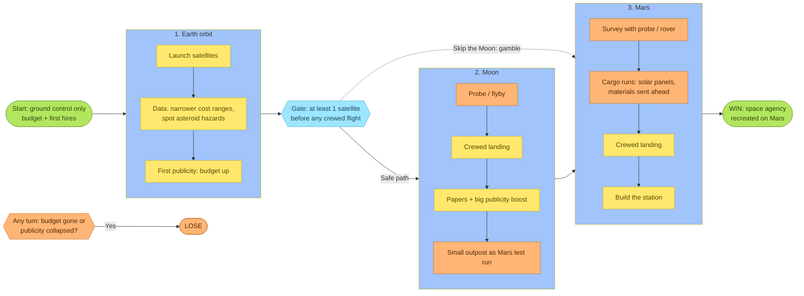
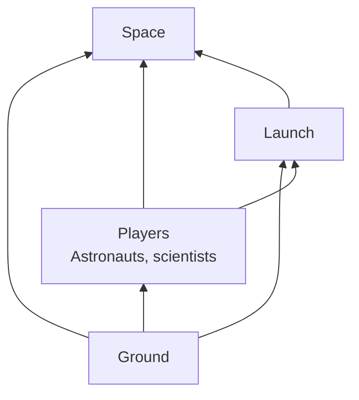

# Moonshot NASA: Miro board export

Source: https://miro.com/app/board/uXjVEOfH7ms=/
Exported 2026-11-14 with the Miro connector: all 131 items, 19 frames, nothing skipped.

Card types: **(proposal)** or **open question** cards are pale orange on the board. They are still to be decided. Plain cards were agreed in the team discussion.

---

## 1. Challenge brief

- **The ask:** design, manage and simulate a complete space mission while making engineering decisions, managing limited resources, and evaluating how choices lead to success.
- **What players design:** spacecraft, scientific instruments, launch vehicle, orbit, power, mass, communications, budget, mission lifetime.
- **Why it matters:** take players from concept to operation (students, aspiring engineers). Show the mission interacting as one complete system, instead of individual tools.
- **How we're judged:** Impact, Creativity, Validity, Relevance, Presentation (presentation counts as much as the rest). Use at least one NASA resource. Pitch Sun 17:30; submission closes Sun 23:59.

## 2. Our approach (decided)

- **Single mission, one fixed brief:** build one complete mission loop for one fixed brief: the Lunar Ice Mapper, a 6U CubeSat flown to lunar orbit. It covers the full brief. Later, make the loop reusable for other briefs.
- **Campaign later:** running the agency across missions (Satellites, Moon, Mars) becomes the outer layer once the core works. See frame 11.
- **Roles as phases, one machine:** each turn is split into role phases. One player plays every role for now. Multiplayer later just means giving each phase to a different player.
- **Economy:** budget is the enabler: it pays for parts, power, engineering. Publicity is the main income source and the brake on risk: a disaster lowers publicity, shrinks the budget and forces smaller missions for a while.

## 3. Turn phases (proposal)

1. **Ground / mission control** (Ittehad): budget, timeline, watch launch windows, comms
2. **Science / users** (Kamel): mission objective, instruments, crew
3. **Space / spacecraft** (Jakob): parts, power, comms hardware
4. **Launch** (Balasz): ride date, transfer to the Moon, lunar capture, go / no-go
5. **Simulate the turn:** planets move, events fire, data comes home, show the outcome

> **Open question:** should phases follow the segments (above) or the people in the game (scientists, astronauts, engineers)?

## 4. Single-mission core loop

Colours show the proposed owner segment: blue Ground (Ittehad), green Science / users (Kamel), purple Space (Jakob), orange Launch (Balasz), yellow shared. Order and ownership are proposals.

```mermaid
flowchart LR
    classDef ground fill:#A0C4FB,stroke:#6A8BBF,color:#14315E
    classDef users fill:#B3E65F,stroke:#84AC43,color:#2F440B
    classDef space fill:#B8ACFB,stroke:#7D6DD4,color:#231266
    classDef launch fill:#FFB575,stroke:#CA7933,color:#542700
    classDef shared fill:#FFE86D,stroke:#CBB333,color:#574900
    classDef decision fill:#9CE6FF,stroke:#4FB1D3,color:#1C4657
    classDef term fill:#DDDDD8,stroke:#A8A8A0,color:#434339

    s([Mission brief: Lunar Ice Mapper<br/>6U CubeSat]):::term
    p1[<b>1. Mission planning</b><br/>objective, requirements,<br/>budget cap]:::ground
    p2[<b>2. Instrument selection</b><br/>science value, mass,<br/>power, data]:::users
    p3[<b>3. Spacecraft config</b><br/>fit it all in 6U: structure,<br/>power, batteries, propulsion,<br/>comms, computer, attitude]:::space
    p4[<b>4. Orbit selection</b><br/>lunar polar orbit:<br/>coverage, comms, lifetime]:::launch
    p5[<b>5. Ride and transfer</b><br/>rideshare date, transfer,<br/>lunar capture, fuel]:::launch
    p6[<b>6. Comms plan</b><br/>ground stations, relays,<br/>bandwidth, coverage]:::ground
    p7[<b>7. Resource check</b><br/>mass, power, budget,<br/>data, comms, time]:::ground
    d{{Go / No-Go}}:::decision
    p8[<b>8. Mission simulation</b><br/>turn by turn: events,<br/>data downlink]:::shared
    p9[<b>9. Evaluation</b><br/>score + report:<br/>why it worked or failed]:::shared
    e([Mission complete]):::term

    s --> p1 --> p2 --> p3 --> p4 --> p5 --> p6 --> p7 --> d
    d -->|Go| p8 --> p9 --> e
    d -.->|No-Go, redesign| p3
    p9 -.->|Try again with changes| p1
```

**The brief (one fixed mission, 6U CubeSat)**
- Objective: map water ice in shadowed craters at the Moon's south pole.
- Ride: secondary payload on a Moon launch leaving on turn 8. Be ready, or wait for the next ride.
- Must: reach lunar orbit with your own propulsion; cover 70% of the south polar region; return X GB of science data; operate 12 turns in orbit.
- Limits: 6U box (about 10 x 20 x 30 cm, ~14 kg), budget cap Y. One turn = one month.

**Success levels:** all requirements met = full success. Data or coverage short = partial. Never captured into lunar orbit, or contact lost = fail. The end report checks each requirement and explains why.

**Why this mission:** most NASA material: CubeSat 101 (parts, sizes, costs, timelines, ground stations), GMAT lunar transfer sample, Mission Viz Earth to Moon demo. Real missions to compare against: Lunar IceCube and Lunar Flashlight (6U lunar ice CubeSats), LRO.

> **Still to set:** X GB data target, budget cap Y, ride on turn 8, 70% coverage, 12 turns in orbit. Missed ride: wait or fail?

- **Covers the brief:** define the objective, design spacecraft and payload, choose launch vehicle and orbit, manage budget, mass, power, comms, data and time, then simulate and evaluate.
- **How turns fit in (proposal):** steps 1 to 7 happen in the role phases before launch. Step 8 runs over several turns: each turn the planets move, events fire and data comes home.
- **Generalise later:** the same loop runs satellite, Moon and Mars missions. Only the parameters change: destination, parts catalogue, budget, launch windows.

## 4b. Core loop step by step (proposal)

### 1. Mission planning (Ground, Ittehad)
- **You decide:** how turns 1 to 8 split into design, build and test before the ride leaves, and how much budget to hold back (CubeSat 101: at least 10%).
- **Trade-off:** less testing frees time and money for better parts but raises failure odds in flight. Too little reserve and one surprise sinks you. Plan too long and you miss the ride.
- **Feeds:** build time for step 3, failure odds for step 8.

### 2. Instrument selection (Science / users, Kamel)
- **You decide:** 1 or 2 instruments from three. IR spectrometer (like Lunar IceCube): maps water across the surface, lots of data. Laser reflectometer (like Lunar Flashlight): sees ice inside dark craters, power hungry. Camera: cheap, weak for ice, great images for the pitch.
- **Trade-off:** more instruments = more science, but more mass, volume, power, data and cost.
- **Teaches:** the science question decides the instrument.
- **Feeds:** power demand, data per turn.

### 3. Spacecraft config (Space, Jakob)
- **You decide:** what fills the 6U box around the instruments: solar panel size, battery size, propulsion (electric: efficient but slow and power hungry; chemical: fast but heavy), radio and antenna, basic or redundant computer, attitude control.
- **Live meters:** volume used of 6U, mass vs ~14 kg, power made vs used, cost vs budget. Nothing may overflow the box.
- **Feeds:** everything after; this is the heart of the game.

### 4. Orbit selection (Launch, Balasz)
- **You decide:** the lunar science orbit. It must be polar to see the south pole. Then altitude: low (~50 km like LRO) gives sharp data and short passes but costs fuel to keep up; higher (~100 km+) covers wider strips and lasts longer.
- **Shown:** estimated coverage per turn, fuel per turn to hold the orbit, time in shadow.
- **Feeds:** coverage rate, battery needs (step 3), fuel budget (step 5).

### 5. Ride and transfer (Launch, Balasz)
- **You decide:** the transfer after the ride drops you off on turn 8. Fast (chemical burn, ~1 turn, lots of fuel) or slow low-energy spiral (electric propulsion, several turns, little fuel).
- **Grounding:** fuel numbers from the GMAT lunar transfer sample; the path drawn with the Mission Viz Earth to Moon demo.
- **Feeds:** arrival turn, fuel left for the capture burn (the riskiest moment) and for holding orbit.

### 6. Comms plan (Ground, Ittehad)
- **You decide:** how data gets home. Own small ground station: cheap, little contact time, low rate. Rented big dishes: costly each turn, high rate. The amateur radio setup in CubeSat 101 works for low Earth orbit, not the Moon.
- **Mechanic:** each turn, data made vs data sent home. Onboard storage fills up; what can't be sent is lost.
- **Feeds:** data returned (a brief requirement), running cost per turn.

### 7. Resource check, Go / No-Go (Ground, everyone)
- **Shown:** the six resources from the challenge (mass, power, budget, data, comms, time) as bars with margin: green, yellow, red.
- **Rule:** Go only if it fits the 6U box and mass, power is positive, budget stays above zero and the build finishes before the ride.
- **Teaches:** every red bar says why in plain words and which step to fix. No-Go sends you back to step 3.

### 8. Mission simulation (everyone)
- **Turn by turn:** build progress, ride on turn 8, transfer, capture burn, then 12 turns in orbit where coverage grows, data is made and sent, batteries drain in shadow.
- **Random events from real missions:** clogged thruster (Lunar Flashlight), lost contact after deployment (Lunar IceCube), radiation reset, budget cut. Better testing in step 1 lowers the odds.
- **You decide each turn:** e.g. switch an instrument off to save power, go to safe mode, spend reserve on a fix.

### 9. Evaluation and report (everyone)
- **Shown:** each brief requirement (capture, coverage, data, lifetime, budget) met or missed, with the reason traced back to a decision.
- **Score:** requirements met, plus science returned vs. cost and risk taken.
- **Compare:** your CubeSat next to Lunar IceCube, Lunar Flashlight and LRO.
- **Then:** try again with changes (the brief asks for repeat runs).

## Mission brief: Lunar Ice Mapper (decided)

This frame has only its title on the board so far. The brief itself is in frame 4.

## 5. Spacecraft parts (to fill in)

Everything must fit in a 6U CubeSat (about 10 x 20 x 30 cm, ~14 kg). Each part has mass, power, cost, data output and science value. Source numbers from CubeSat 101 and the lunar CubeSats. Owner: Jakob (space segment).

| Part | Options | Mass (kg) | Power (W) | Cost | Data | Science value |
|---|---|---|---|---|---|---|
| Structure | 6U bus (10 x 20 x 30 cm) | | | | | |
| Power | Deployable solar panels | | | | | |
| Batteries | Small / large | | | | | |
| Communications | Low-gain, high-gain antenna | | | | | |
| Onboard computer | Basic / redundant | | | | | |
| Attitude control | Reaction wheels, thrusters | | | | | |
| Instruments | IR spectrometer, laser reflectometer, camera | | | | | |
| Propulsion | Electric (ion), chemical | | | | | |

## 6. Data and communications (to fill in)

- **Data generated:** instruments produce data every turn. Volume per instrument: TBD.
- **Getting it home:** the Moon is far beyond the low orbits CubeSat 101 covers, so the radio and ground station must be stronger. Bandwidth and coverage windows limit how much data gets through each turn.
- **Science return (proposal):** only data that reaches the ground counts toward the mission's science score.

> **Open questions:** units for bandwidth and data? Onboard storage that fills up? Are relay satellites their own missions, or a part you buy?

## 7. Orbits and trajectories (to fill in)

- **Ride and transfer:** the ride leaves on a fixed turn. After deployment the CubeSat uses its own propulsion to reach the Moon and capture into orbit, which can take several turns.
- **Choosing a trajectory:** trade fuel and propulsion type against transfer time: faster costs more fuel and mass. Pick what fits your current fuel, mass, comms coverage and budget.
- **Orbit trade-offs:** only a polar orbit passes over the south pole, so it is required for coverage. Lower orbit gives sharper data but costs fuel to keep up; altitude also changes comms and lifetime.
- **NASA sources for real numbers (proposal):** GMAT (trajectories, launch windows, fuel), Ames Trajectory Browser (launch dates vs destinations), NASA Mission Viz (visual layer).

## 8. Scoring and economy

- **Budget:** the enabler. It pays for spacecraft parts, power, engineering and launches.
- **Publicity (campaign layer):** main income source. Lose astronauts and publicity drops, the budget shrinks, and you fly smaller missions until you recover. This is what keeps risk in check.
- **Single-mission score (proposal):** check each brief requirement (coverage, data, lifetime, budget), then score science returned vs. cost and risk taken. The report explains why each was met or missed.

> **Open questions:** score weights? Difficulty levels or scenarios (the brief asks for several)? What counts as mission failure vs. partial success?

## 9. Team and next steps

| Person | Segment |
|---|---|
| Balasz | Launch: vehicle, orbit, trajectory, windows |
| Kamel | Users: science objective, instruments, crew |
| Ittehad | Ground: mission control, budget, comms, data |
| Jakob | Space: spacecraft parts, power, operations |

**Next steps**
1. Set the placeholder numbers in the mission brief
2. Settle the turn phases (frame 3)
3. Fill in parts, data and comms, orbits with CubeSat numbers (frames 5 to 7)
4. Build the single-mission loop end to end (frame 4)
5. Pick the NASA resources we visibly use (frame 10)
6. Leave time for the pitch: 7 slides or 30 s video, Sun 17:30

## 10. NASA resources by segment

- **Whole game:** NASA "Design and Develop Science Missions": defines the launch, space, ground and user segments, matching our four roles.
- **Launch and orbits:** GMAT (trajectories, launch windows, manoeuvres), NASA Mission Viz (3D trajectories).
- **Space and science:** CubeSat 101 (satellite missions), Webb telescope learning game (instrument and config screen, levels, end report).
- **Ground and process:** Goddard Mission Design Lab (disciplines as roles), JPL Concept Maturity Levels (progression), CSA games (teaching ideas).

## 11. Campaign layer (later): overall progression

Overall progression (draft v1):

**Legend**
- Yellow: from the team discussion
- Orange: Claude's proposals, still to be decided
- Blue: rule or decision point
- Green: start and end states

Gating model (draft): hybrid. A few hard gates (e.g. a satellite before any crewed flight); inside those, players choose their own path.

**Open questions for the team**
1. Can a bold player skip the Moon and go straight to Mars?
2. Do we want a Moon outpost as a test run, or is the Moon just a landing?
3. How do you lose: bankruptcy, publicity collapse, both, or never?
4. What exactly counts as a recreated agency on Mars (which buildings)?
5. Are there more hard gates (e.g. a cargo run before a crewed Mars landing)?

---

# Earlier drafts (superseded)

## Concept and segments

- **Game concept:** starting state: you have a space agency / company with budget, time, resources, workforce etc. Goal state: replicate the space agency on another planet.
- **Global currencies:** budget, mass, workforce, publicity, data, power, time.

Segment diagram (redrawn from the board's arrows):

- **How the segments connect:** ground control is the starting point: it hires the players and supports every mission. Players and ground feed both launch and space, and launch delivers into the space segment.

## Game loop and economy

- **Start and win:** turn-based, single player. Start with a small space agency: budget, workforce, power, a basic lab and a basic space station (both upgradeable). You win by recreating the agency on another planet.
- **Income and costs:** recurring agency income vs. fixed costs (hire too many people and you go bankrupt). Budget is converted into other resources, e.g. solar panels for power. Upgrades and structures have requirements (e.g. 2 solar panels + steel).
- **Milestones and publicity:** first satellite, Moon landing, traces of life: publicize or publish a paper for more budget. A publicity bar drops when an astronaut dies or a mission fails, which lowers future budget.

## Turn-based mission planning

- **Turns and timing:** each turn the budget moves with your run rate. Wait for planetary alignment (launch windows). Building too early wastes budget. Pre-launch checks: trajectory, fuel, materials, payload.
- **Rockets and payload:** materials have weight; rockets have payload capacity (e.g. 3 rocket types, or light rocket engineering). Research ships earn papers and money; cargo ships carry materials to other planets.
- **Uncertainty and risk:** costs are ranges (Moon: 1,000 to 1,500 L fuel). Satellite data narrows them (1,200 to 1,300) and reveals hazards like asteroids. Gamble on the low end for a big reward. Random failures with 30-second decisions.

## Scientific grounding

- **Audience:** NASA's brief targets students and aspiring engineers: practical intuition for how space missions are run, not just theory.
- **Real NASA data and imagery:** use NASA data wherever possible to keep the game realistic. Real photos (Moon craters, Mars) power interactive mini-tasks, e.g. counting craters.
- **Mission engineering at the core:** small scientific puzzles inside missions. Planning (set parameters, allocate budget) is a central mechanic: low-risk/low-reward vs. high-risk/high-reward missions.

## MVP roadmap (2 days)

**1. Satellites** (collect data, narrow estimates, spot hazards) → **2. Moon** (first big milestone) → **3. Mars** (rebuild the Earth station: win)

- **Build order:** get the core game logic working first, so the game already works and makes sense. Fancy graphics and extra interactivity only with spare time.
- **Flow between segments:** start with only ground control. Ground control (budget, tech tree, publicity) → hire staff → plan the mission → space segment. Define these shared interfaces before splitting up.

## Work split and next steps

| Person | Area |
|---|---|
| Balasz | Mission / launch: flying the rocket, mission planning |
| Kamel | Users: scientists, astronauts, staff interactions |
| Ittehad | Ground control: foundation, budget, tech tree, mission support |
| Jakob | Space segment: stations, experiments in orbit and on planets |

**Next steps**
1. Agree on shared components and interfaces, then work in parallel
2. Jakob pairs with Balasz on the mission part first
3. Have AI build a core prototype from the memo + NASA docs
4. Have AI index the NASA resources by game segment
5. Each owner polishes their segment
